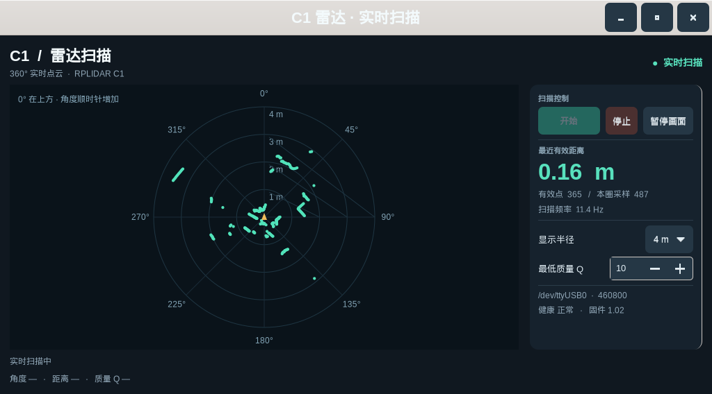

# Embedded Linux System Development and LiDAR Visualization on STM32MP257F-DK

An embedded Linux project covering Linux kernel customization, user-space Hello World
and serial menu applications, and RPLIDAR C1 data acquisition and visualization
on the STM32MP257F-DK development board.

## Project Features

| Component | Functionality |
| --- | --- |
| Kernel Hello World | Print greetings during kernel initialization and add an approximately 10-second wait before continuing startup. |
| User-space Hello World | Print a greeting, count down from 10 to 0, and exit. |
| Serial menu | Display the greeting and running kernel version, echo text, run a countdown, and return to the shell. Start automatically after serial login. |
| LiDAR application | Acquire RPLIDAR C1 measurements and display scans in a GTK 3 application on the board's HDMI screen. |

### Kernel Customization

The project patch modifies `init/main.c` in Linux 6.6.116 after the official ST
`v6.6-stm32mp-r3` patch has been applied:

- In `start_kernel()`, print an early greeting immediately after `console_init()`.
- In `kernel_init_freeable()`, print the kernel greeting after `do_basic_setup()`,
  call `msleep(10000)`, and then print `Continue!`.

The patch is provided in
[`kernel-hello-world/add-boot-greeting.patch`](kernel-hello-world/add-boot-greeting.patch).
Kernel images, modules, and the rebuilt `galcore.ko` GPU module must use the same
generated kernel release.

### User-space Applications

The basic Hello World application and its serial menu extension are maintained
in separate directories, each with its own source file and Makefile:

- [`apps/hello-world/`](apps/hello-world/README.md): greeting and countdown.
- [`apps/serial-menu/`](apps/serial-menu/README.md): interactive application and serial login configuration.

The menu provides the following options:

| Option | Action |
| --- | --- |
| `1` | Show the greeting. |
| `2` | Show the running kernel release using `uname()`. |
| `3` | Read and echo a line of text. |
| `4` | Run the countdown from 10 to 0. |
| `0` | Exit to the shell. |

The login hook starts the menu on `/dev/ttySTM0`. SSH sessions open a regular
shell.

### LiDAR Acquisition and Visualization

The acquisition program uses the bundled SLAMTEC RPLIDAR SDK 2.1.0 and its
`ultra_simple` example. The C1 connects to a board USB Host port through a
CP2102N adapter at **460800 baud**; Linux provides the `cp210x` and `usbserial`
drivers.

The GTK 3 interface supports:

- Starting, stopping, and restarting acquisition.
- Pausing the display while acquisition continues.
- Selecting a display radius of 1, 2, 4, 6, or 12 meters.
- Filtering points by measurement quality.
- Displaying the nearest valid distance and inspecting individual points.
- Stopping the acquisition subprocess when the window closes.

The interface uses Chinese labels and includes a font with its license files.
The supplied Weston configuration sets HDMI to 1024 x 600 and disables the
DSI, DPI, and LVDS outputs.



## Hardware and Software

| Item | Configuration |
| --- | --- |
| Development board | STM32MP257F-DK, A35-TD, ARM64 Linux on Cortex-A35 |
| Storage | microSD card of at least 16 GB |
| Display | 1024 x 600 HDMI screen |
| Serial console | ST-LINK virtual serial port, 115200 baud; board console `/dev/ttySTM0` |
| LiDAR | RPLIDAR C1 with CP2102N USB adapter, 460800 baud |
| Host | Ubuntu / Kubuntu 22.04, x86_64, Bash |
| STM32CubeProgrammer | 2.23.0 |
| OpenSTLinux packages | Matched STM32MP2 A35-TD FLASH, SDK, and SOURCES packages, v26.02.18 |
| Distribution | OpenSTLinux Weston 5.0.15, Yocto scarthgap |
| Kernel | Linux 6.6.116 with ST `v6.6-stm32mp-r3` patches |
| Toolchain | `aarch64-ostl-linux-`, GCC 13.4.0 |
| External device tree | `external-dt-v6.0-stm32mp-r3`, `stm32mp2/a35-td/linux` |
| GPU driver | `gcnano-driver-stm32mp-6.4.21-r1`, rebuilt for the selected kernel |
| LiDAR SDK | SLAMTEC RPLIDAR SDK 2.1.0 |
| GUI runtime | Python 3, PyGObject, GTK 3, PangoCairo, pycairo, Weston/Wayland, `stdbuf`, and fontconfig |

## Repository Layout

```text
.
|-- README.md
|-- HOW_TO.md
|-- README.zh-CN.md
|-- kernel-hello-world/
|   |-- README.md
|   |-- add-boot-greeting.patch
|   |-- kernel-build.config
|   `-- reference/init/main.c
|-- apps/
|   |-- hello-world/
|   |   |-- hello_world_example.c
|   |   `-- Makefile
|   `-- serial-menu/
|       |-- hello_world_example.c
|       |-- Makefile
|       |-- serial-menu.profile
|       `-- serial-getty-menu.conf
|-- lidar/
|   |-- rplidar_sdk-master/
|   |-- ui/
|   |-- scan-verification.log
|   `-- verification-summary.json
|-- scripts/
|   |-- env-v26.02.18.sh
|   `-- build-apps.sh
`-- docs/
    `-- stm32mp257-reproduction/
        `-- assets/
```

## Build and Run

Use the [English reproduction guide](HOW_TO.md)
for host preparation, SDK installation, source patches, kernel builds, board
deployment, HDMI configuration, and verification. A
[Chinese translation](README.zh-CN.md) is provided separately.

Follow this sequence:

1. Install the matching host tools and SDK, and prepare the board system.
2. Apply the ST kernel patch, then the project greeting patch.
3. Configure and build the kernel, external device tree, modules, and GPU driver.
4. Deploy the matching outputs and configure the 1024 x 600 HDMI display.
5. Build and deploy the user-space applications and install the serial login hook.
6. Build and deploy the C1 acquisition program, then install and launch the GUI.

### Build the User-space Applications

After installing the v26.02.18 SDK, open Bash in the repository root. Adjust
`STM32_DEV_ROOT` and `SDK_DIR` below to your chosen working and SDK installation
directories, then load the environment:

```bash
export PROJECT_ROOT="$(pwd -P)"
export STM32_DEV_ROOT="$PROJECT_ROOT/work/Developer-Package"
export SDK_DIR="$STM32_DEV_ROOT/SDK-v26.02.18"
source "$PROJECT_ROOT/scripts/env-v26.02.18.sh"
```

Build the two applications independently:

```bash
make -C "$PROJECT_ROOT/apps/hello-world" clean &&
make -C "$PROJECT_ROOT/apps/hello-world"

make -C "$PROJECT_ROOT/apps/serial-menu" clean &&
make -C "$PROJECT_ROOT/apps/serial-menu"

file "$PROJECT_ROOT/apps/hello-world/hello_world_example"
file "$PROJECT_ROOT/apps/serial-menu/hello_world_example"
```

Both executables must be reported as AArch64 ELF files. Each application has an
executable named `hello_world_example` in its own build directory. To create
stripped release executables, run:

```bash
bash scripts/build-apps.sh
```

### Install the Serial Menu

Follow the [serial menu installation instructions](apps/serial-menu/README.md)
to upload the executable, run it on the board, and optionally install the serial
login hook. The guide includes the configuration commands, reboot checks, and
steps to remove automatic startup.

### Launch the LiDAR GUI

After deployment, stop command-line acquisition and run the following in the
board shell. Set `LIDAR_DEVICE` to the C1 device identified on the board:

```sh
export LIDAR_DEVICE=/dev/ttyUSB0
/usr/local/bin/rplidar-ui --device "$LIDAR_DEVICE"
```

The window appears on the board's HDMI display. Click Start to begin scanning.

The environment helper sets the kernel build user to `builder` and build host
to `buildhost`.

## Build Outputs and Release Assets

Use the repository's Releases page to distribute the following files:

| Asset | Contents |
| --- | --- |
| Kernel image package | Recompiled `Image`, compressed `Image.gz`, matching device tree, modules, and build configuration |
| Hello World application package | Basic application executable, source, and Makefile |
| Serial menu application package | Menu executable, source, Makefile, and login configuration |
| Complete source package | Project sources, BSP source archives, configuration, and documentation |

Keep the two application executables in separately named packages. The compiled
serial menu is the extended version of the user-space application.

Use the release generated by each kernel build for its image, modules, and GPU
driver. Kernel deployment also requires the matching device tree and modules;
the complete deployment procedure is documented in the reproduction guide.

## Verification

After deployment, check the following:

- Kernel greetings appear over serial, with approximately 10 seconds between
  the kernel greeting and `Continue!`.
- The running kernel release matches the deployed modules and GPU driver.
- Hello World prints the greeting, completes its countdown, and exits.
- The serial menu starts after serial login, accepts input, and exits with option `0`.
- The HDMI desktop displays correctly at 1024 x 600.
- Command-line acquisition reports scanner health and angle, distance, and quality.
- The GUI can start, pause, stop, and restart acquisition, and close cleanly.

Run the scan-processing tests on the host using system Python:

```bash
/usr/bin/python3 -m unittest discover -s lidar/ui -v
```

Recorded acquisition data, a GUI report, and a screenshot are included under
`lidar/` and `lidar/ui/`. Point counts vary with the scanned environment.

## Third-party Components

The project uses ST's OpenSTLinux components, the SLAMTEC RPLIDAR SDK, and the
bundled font. Their original copyright notices and license files accompany the
corresponding sources and assets.
